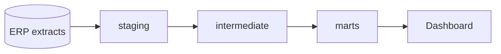

# Portfolio README

A portfolio README is read by two people. A recruiter gives it 30 seconds and
must see what was built, why it matters and what it shows about the author.
An engineer then checks whether it runs and whether the decisions make sense.
Write the top for the first and the rest for the second.

## Rules

- **English**, plain and direct. No marketing adjectives ("robust",
  "cutting-edge", "seamless"). No em dashes.
- **The first screen answers three questions**: what it is, what problem it
  solves, what the result is (with a number when possible).
- **Every command is copy-pasteable and was run** before it went in the
  README. Show the output when it proves something (tests passing, row counts).
- **Diagrams in Mermaid**, so they render on GitHub and stay editable.
- **Fictional or public data only.** No client names, logos, internal URLs or
  real extracts. Say where the data comes from.
- **Link, do not repeat**: decisions live in `docs/decisions.md` and ADRs,
  details in `docs/`. The README points to them.
- **Short beats complete.** If a section has nothing real to say, drop it.

## Skeleton

````markdown
# <Project name>

<One sentence: what it is and for whom.> <One sentence: the result, with a number.>


## Why

<The problem in two or three sentences, framed as a business question.
Fictional context is fine: "A distribution company needs daily OTIF by
carrier to renegotiate contracts.">

## Architecture



<Two or three sentences on the main choices, each linking to its ADR.>

## What it shows

- <Skill demonstrated, with where to see it: "Incremental model with a
  justified 45-day lookback: models/marts/fct_deliveries.sql">
- <Another one.>

## Run it

Prerequisites: <Python 3.12 with pyenv, Poetry, Docker (optional)>.

```bash
git clone <repo-url>
cd <repo>
poetry install
cp .env.example .env
poetry run dbt build
```

## Project structure

```text
<tree of the main folders, 10 lines at most>
```

## Quality

<How correctness is checked: dbt tests, unit tests, lint, CI. One line each.>

## Next steps

- <What would come next, honestly.>

## Author

<Name>, <role>. <LinkedIn or contact link>.
````

## Repository checklist

The README is the front door; the repository behind it is judged too.

- [ ] `LICENSE` file (MIT unless the user chooses otherwise).
- [ ] `.env.example` with names only; no secrets anywhere in history.
- [ ] `.gitignore` covers data, credentials, build output.
- [ ] CI runs lint and tests on pull requests, and the badge is green.
- [ ] Commit messages follow Conventional Commits (`feat:`, `fix:`, `docs:`).
- [ ] Work happens on branches merged by pull request, even when working alone.
- [ ] Third-party GitHub Actions pinned to a commit SHA, not a tag.
- [ ] Docker images, if any, run as a non-root user.
- [ ] Screenshots or sample output in `docs/images/`, referenced from the README.
- [ ] Repository description and topics set on GitHub.

## Workflow

1. Read the project: `CLAUDE.md`, `docs/spec.md`, `docs/decisions.md`, the
   folder tree, CI config.
2. Ask for what the files cannot tell: the target audience (role and level),
   the result numbers, links to show (dashboard, LinkedIn).
3. Run the "Run it" commands in a clean shell and fix the README (or the
   project) until they work.
4. Write the README from the skeleton, dropping empty sections.
5. Go through the repository checklist and report what is missing, without
   changing it unless the user asks.
6. Check: no em dashes, no client names, every link resolves.
